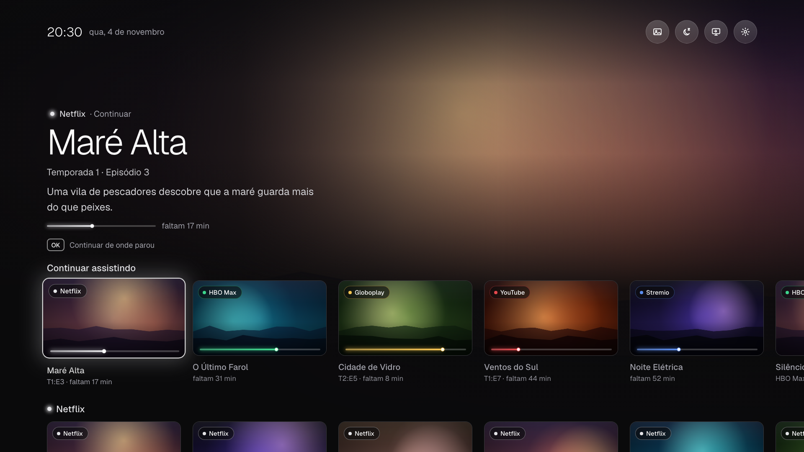

# Cinema: uma Home nova para Android TV

*English summary: a replacement Home (launcher) for Android TV 9+, built and tested on a Sony BRAVIA KD-65X755F
(Brazil). Continue watching from every app, one row per streaming service, an apps grid, a backdrop of the
title in focus, and every setting in one side panel. Plain Android views, no Gradle, no Google Play services.
Pairs with [`tvkeys/`](../tvkeys/README.md) for the remote's colour buttons.*

<p align="center"></p>

Launcher próprio (`br.casa.cinema`), escrito com as views do Android, sem Gradle e sem bibliotecas. Feito e
testado numa Sony BRAVIA KD-65X755F (Android TV 9); deve funcionar em outras Android TV 8+ que mostram o
"Assistir a seguir" (Watch Next) dos apps.

## O que tem

- **Continuar assistindo** reunindo todos os streamings, o último que você mexeu primeiro. Segurar OK num
  título: continuar ou remover da lista (ele volta sozinho quando você assiste de novo no app).
- **Uma linha por streaming** (o que você está vendo e as recomendações do próprio app), ordenadas pelo uso ou
  na ordem que você definir.
- **Fundo** com a arte do título em destaque, composto numa imagem só, em tom neutro.
- **Grade de Apps** (o botão Apps do controle abre direto nela, com o `tvkeys`). Segurar OK num app: abrir,
  ocultar da Home, desinstalar (apps instalados) ou desativar (apps de fábrica). A Play Store fica logo depois
  dos streamings.
- **Topo:** Quadro (liga o Modo ambiente na hora), Desligar (temporizador da TV), Entradas (o mesmo seletor da
  tecla Input) e Ajustes.
- **Ajustes**, num painel lateral:
  - **Ajustes da TV**: as configurações da própria TV;
  - **Home**: ordem das linhas, quais streamings aparecem e apps ocultos;
  - **Botões do controle**: qual app cada cor abre.
- Navegação pensada para o controle: para os lados nunca muda de linha; Cima/Baixo volta ao último card de
  cada linha; Voltar sobe um nível por vez.

Medido numa KD-65X755F (MediaTek MT5891) com `tools/bench.py`, comparado à Home do Google:

| Medida | Home do Google | Cinema |
|---|---|---|
| Abrir um app | 919 ms | 330 ms |
| Voltar para a Home | 205 ms | 72 ms |
| CPU parada | 9,8% | 0,1% |
| Memória | 124 MB | 88 MB |

## Compilar

Precisa de um JDK 17 a 22 (`JAVA_HOME`) e do Android SDK (`ANDROID_HOME`) com `platforms/android-34` e
`build-tools/36.0.0`. O APK é assinado com a chave de debug padrão (`~/.android/debug.keystore`).

```bash
cd cinema && python3 build.py
```

## Instalar

Com a depuração ligada na TV e `tools/` configurado como no README principal:

```bash
TV_HOST=<ip da TV> tools/venv/bin/python -I tools/b64push.py cinema/build/cinema.apk /data/local/tmp/cinema.apk
TV_HOST=<ip da TV> tools/venv/bin/python -I tools/tv.py 'pm install -r /data/local/tmp/cinema.apk; rm -f /data/local/tmp/cinema.apk; pm grant br.casa.cinema android.permission.READ_TV_LISTINGS; appops set br.casa.cinema GET_USAGE_STATS allow; cmd package set-home-activity br.casa.cinema/.Home'
```

- `READ_TV_LISTINGS` deixa a Cinema ler o "Assistir a seguir" e os canais dos apps.
- `GET_USAGE_STATS` diz quando cada app foi usado por último, para ordenar o que não tem data.
- `set-home-activity` faz dela a Home. Instalar outro launcher depois desfaz isso: rode o comando de novo.

`tools/tv.py --push` trava com arquivos acima de ~140 KB; por isso o `b64push.py`.

## Desfazer

```bash
TV_HOST=<ip da TV> tools/venv/bin/python -I tools/tv.py 'cmd package set-home-activity com.google.android.tvlauncher/.MainActivity; pm uninstall br.casa.cinema'
```

## Como funciona

| Arquivo | Papel |
|---|---|
| `Home.java` | a tela, as linhas, o foco, o topo e os menus |
| `Data.java` | Watch Next, canais e prévias dos apps (TvProvider), apps instalados, último uso |
| `Backdrop.java` | compõe o fundo (desfoque + arte inteira + sombras) num thread separado |
| `SettingsPanel.java` | o painel lateral único de Ajustes e dos menus de segurar OK |
| `Botao.java` | recebe as teclas coloridas do `tvkeys` e abre o app escolhido |
| `Rounded`, `Glow`, `ProgressGlow`, `Icon`, `Spring` | desenho dos cards, brilhos, ícones e a curva das animações |

Desempenho: o fundo é uma imagem pré-composta de 1280×720; os cantos arredondados são desenhados na própria
imagem (recortar com `clipToOutline` era o mais caro neste chip); as linhas fora de foco ficam em cache de GPU.

Fonte: [Geist](https://vercel.com/font) (SIL Open Font License, em `assets/fonts/OFL.txt`).
